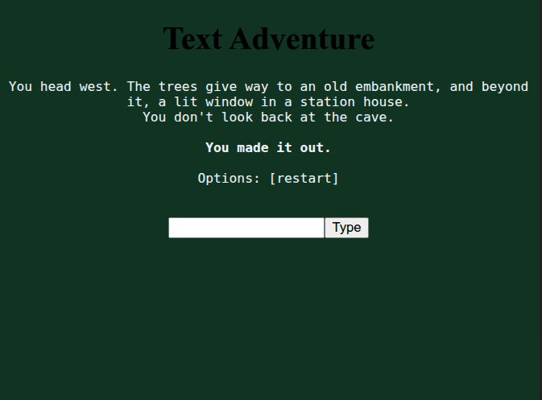

# Text Adventure

Welcome to my Text Adventure.

## Why a Text Adventure?

I wanted to learn how to make one in the browser. I've played some before, but this is the first one I create in the browser.
(I made a small local one for school once tho, but that one was in Bash, not HTML and JS)

## How to use?

- Go to https://gauthammu.github.io/textadventure/
- Just type one of the listed Options into the text field
- Click on "Type" (sorry, couldn't figure out how to make it send when pressing enter)

## Future features

- Navigation by typing "North", "East", "South" or "West" in an input field (Done using AI)
- Somewhat of a Story (hopefully) (nvm it's a lost cause at this point)
